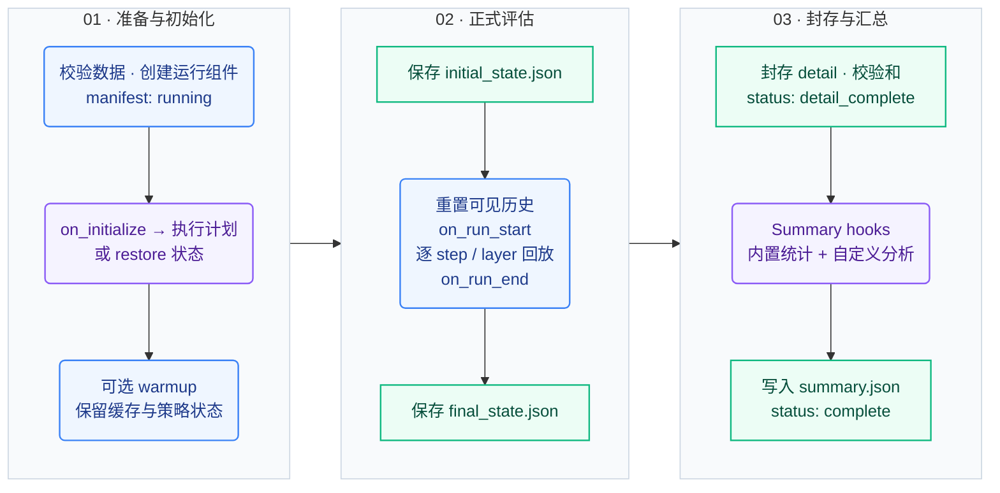
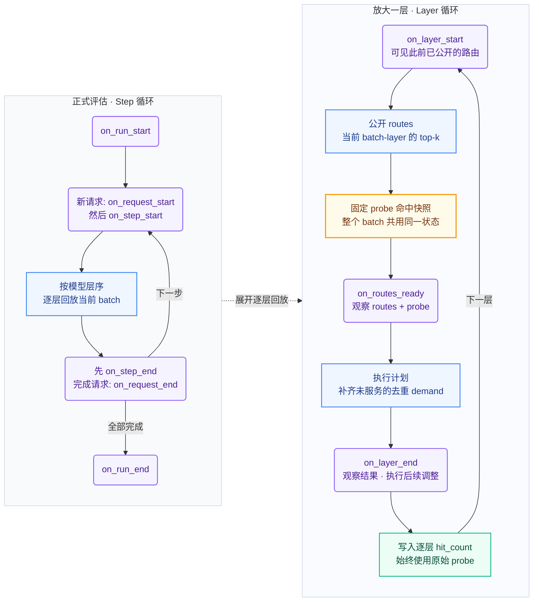
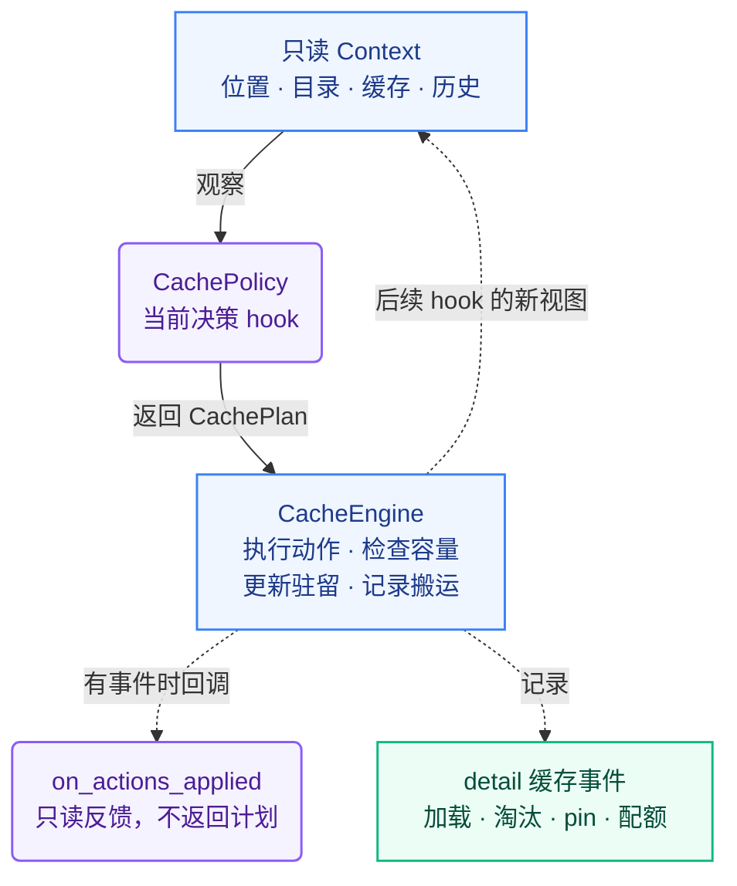
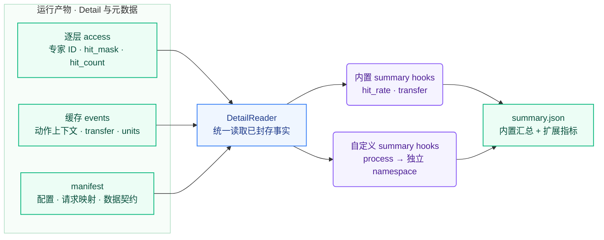

# ExpertCacheBenchmark

离线专家缓存 benchmark：按照模型前向的信息公开顺序回放路由，通过固定生命周期的 hooks 执行缓存策略，输出逐 `request / token / layer / top-k` 命中标注，再独立生成 summary。

当前评估目标是**命中率与权重搬运量**。专家大小默认用虚拟单位表示，时序接口已预留；v1 不模拟计算耗时、异步传输或 TPOT。内置 LFU、Strata adaptive residency 和 Belady 离线基线。

**阅读导航** · [快速开始](#quick-start) · [生命周期](#lifecycle) · [Hooks 导图](#hooks) · [缓存与初始化](#cache) · [Detail → Summary](#outputs) · [实验结果](docs/results/capacity-sweep-20261018.md)

| 输入 | 回放与决策 | 输出 |
| :--- | :--- | :--- |
| 路由轨迹 + 实验配置 | 固定生命周期 + 可替换策略 hooks | 逐层 **detail** + 可扩展 **summary** |
| Pydantic 契约 · 数据指纹 | 因果可见性 · 统一容量与搬运计费 | 命中标注 · 缓存事件 · 独立后处理 |

## Quick Start

以下命令均在仓库根目录执行，需要 Python 3.11+。

```bash
python3 -m venv .venv
source .venv/bin/activate
python -m pip install -e .

# 校验 manifest、全部路由数组及数据指纹
expertcache validate dataset/router_results_sample100/benchmark.json

# 冷启动 LFU：4 个请求 × 32 token，batch=4
expertcache run configs/lfu-smoke.json --output runs/quickstart-lfu

# 只从已封存 detail 重算 summary，无需重新回放
expertcache postprocess runs/quickstart-lfu

# 导出便于查看的逐层 JSONL 标注
expertcache export-detail runs/quickstart-lfu --output runs/quickstart-lfu/access.jsonl

# 运行测试
python -m unittest discover -s tests -v
```

依赖为 NumPy 和 Pydantic 2。已有依赖时，也可以用 `PYTHONPATH=src python -m expertcache ...` 代替 `expertcache ...`，无需安装项目。`run` 输出目录、`profile` 输出文件和 JSONL 导出文件必须不存在；重复执行时请换一个名字。

这次 smoke 会产生 5,120 条逐层判断，常驻池为 1,024 units，另有 1 unit workspace。查看 `runs/quickstart-lfu/summary.json` 的 `hit_rate` 和 `transfer` 即可获得汇总结果。

### 用同一初始化比较 LFU 与 Strata

先用前 20 个请求生成独立 profile，再在其后的请求上评估。两种策略使用同一份 profile 和容量配置。

```bash
expertcache profile dataset/router_results_sample100/benchmark.json --max-requests 20 --output runs/profile-train20.json
expertcache run configs/lfu-profile-smoke.json --output runs/quickstart-lfu-profile
expertcache run configs/strata-smoke.json --output runs/quickstart-strata
```

这里每组评估 4 个留出请求 × 32 token。已有 `runs/profile-train20.json` 时可直接复用。完整留出集使用 `configs/lfu-eval.json` 和 `configs/strata-eval.json`，各评估其余 80 个请求 × 512 token。`configs/lfu-full.json` 则对全部 100 个请求做冷启动回放。

当前数据按原始顺序划分，前 20 个请求均来自 math 子集；这是可复现实验划分，不能据此推断所有任务上的算法排名。Strata 的规则、参数及与真实引擎的差别见 [docs/strata.md](docs/strata.md)。

Belady 使用相同 profile，运行 `expertcache run configs/belady-eval.json --output runs/belady-eval`。它在显式 oracle 模式下，用未来路由最小化等大小全局池的去重需求加载；batch 重复访问的加权命中率不保证最优。适用条件与追加原实验的方法见 [docs/belady.md](docs/belady.md)。

<a id="lifecycle"></a>

## 一次实验的生命周期

`Benchmark` 推进固定流程，`CachePolicy` 在 hooks 中提出动作，`CacheEngine` 执行动作并维护真实驻留状态。**一次 run 内所有请求共享缓存，每次新 run 创建独立缓存。**

### 全局视图 · 从初始化到可重算的结果

图中统一使用：**蓝色 = 框架流程**，**紫色 = 策略扩展点**，**琥珀色 = 命中判定快照**，**绿色 = 数据产物**。实线表示执行顺序，虚线表示局部放大或数据反馈。



- **初始化分支**：`restore` 跳过 `on_initialize`；其余模式先执行初始化 hook，`preload` 再执行显式加载。独立 profile 通过初始化 hook 交给策略。
- **预热边界**：warmup 不额外触发 `on_run_start/on_run_end`。`initial_state.json` 保存于 warmup 之后、正式 `on_run_start` 之前；正式起始 hook 的加载计入 evaluation 搬运。
- **失败恢复**：回放失败标记 `failed`，未封存 detail 不能汇总；后处理失败保留 `detail_complete`，修复插件后可直接 `postprocess`。每个 `Benchmark` 实例只能运行一次。

### 放大一个前向 · Step → Layer → Top-k 标注

每个 decode step 中，每个活跃请求贡献一个 token；按模型层序公开**整个 batch 当前层**的路由。紫色决策 hook 返回的计划都会在进入下一阶段前执行。



左侧管理 step，右侧展开逐层回放；最后一层写完标注后，回到左侧的 step 收尾。

> **命中判断先于需求加载。** 本层换入的专家不会把已经判定的 miss 改成 hit；3 个请求同时缺同一个专家，会留下 3 次 miss 标注，但只需要 1 次 demand 加载。

<a id="hooks"></a>

## Hooks 与可见信息

### 一次 hook 调用 · 观察 → 决策 → 执行 → 反馈

策略拿到只读 `Context`，返回 `CachePlan`；框架将计划交给 Engine 顺序执行。**策略决定缓存什么，Engine 负责容量检查、真实状态与搬运记录。**



普通模式只公开已发生的路由；`visibility="oracle"` 才额外开放未来轨迹供 Belady 等离线基线使用。接口定义见 [api.py](src/expertcache/api.py)，固定调用流程见 [runner.py](src/expertcache/runner.py)。

<details>
<summary><strong>展开完整 hook 速查：调用时机、可见信息与常见用途</strong></summary>

以下决策 hook 默认返回空计划，可以按需覆盖。

| Hook | 此时可以看到什么 | 常见用途 |
|---|---|---|
| `on_initialize(ctx, profile)` | 空池、专家目录、可选的独立 profile | 初始化策略状态，按 profile 预装专家 |
| `on_run_start(ctx)` | 初始化或预热后的缓存 | 正式评估开始时的准备 |
| `on_request_start(ctx, request)` | 新请求 ID 与 metadata | 建立请求级状态 |
| `on_step_start(ctx, step)` | 当前 batch 的请求 ID、token 索引 | 跨请求协调、基于历史预取 |
| `on_layer_start(ctx, layer_id)` | 当前层编号、此前已公开的路由 | 在当前层路由公开前预取 |
| `on_routes_ready(ctx, routes, probe)` | 当前 batch-layer 的全部 top-k、固定的命中与缺失集合 | 统计访问，制定换入与淘汰计划 |
| `on_layer_end(ctx, resolution)` | 本层 routes、原始 probe、需求服务产生的事件 | 本层完成后的调整 |
| `on_step_end(ctx, step)` | 当前 step 各层都已公开 | 周期衰减、跨层适应、下一步预取 |
| `on_request_end(ctx, request)` | 本步结束的请求 | 释放请求级状态 |
| `on_run_end(ctx)` | 最终评估状态 | 收尾动作 |

</details>

`on_actions_applied(ctx, events)` 只观察执行结果，不返回计划。`state_dict()/load_state_dict()` 用于保存、恢复策略的 JSON 可序列化状态；`metadata()` 将算法参数和说明写入运行 manifest。

`Context` 是只读视图，主要包括：

- `phase / hook / step_id / layer_id`：当前生命周期位置。
- `catalog`：`(layer_id, expert_id) → size_units` 专家目录。
- `cache`：驻留与 pin 集合、全局容量、已用量、workspace、各层配额与已用量。
- `history.routes(request_id, token_index, layer_id)`：本阶段已公开的路由。读取未来信息会抛出 `PermissionError`。
- `oracle`：仅在配置 `visibility="oracle"` 时提供完整选中请求的路由视图；`oracle.batches()` 按实际调度顺序遍历本阶段所有 batch-layer，并在 manifest 标记该模式。

默认 `visibility="causal"`。普通 Context 不提供原始 trace 或请求未来长度；warmup 与 evaluation 的历史视图分开，跨阶段统计应保存在策略状态中。Python 插件属于受信任代码，因果接口不隔离主动绕过接口的插件。

### 动作计划

```python
from expertcache.api import Action, CachePlan

# 示例：先淘汰一个专家，再把另一个专家装入常驻池
plan = CachePlan(actions=(
    Action("evict", key=(3, 7), reason="adaptation"),
    Action("load", key=(3, 9), reason="adaptation"),
))
```

| 动作 | 语义 |
|---|---|
| `load` | `retain=True` 装入常驻池；`retain=False` 经 workspace 临时加载并释放 |
| `evict` | 淘汰常驻专家；不能淘汰 pinned 专家 |
| `pin / unpin` | 设置或解除淘汰保护；pin 仍占常驻预算 |
| `quota` | 动态层配额，使用 `key=(layer_id, -1), units=新配额` |

Engine 按顺序执行动作，不代替策略选择淘汰对象。需要先释放空间再常驻加载；动态配额调整也要先释放配额，再分给另一层，且不能低于该层当前驻留量。建议 `reason` 使用 `initialization / demand / prefetch / adaptation`，以便内置 summary 分类计费。

### 接入自定义策略

继承 `CachePolicy`，通过 `policy.name="模块名:类名"` 注册，`policy.params` 作为构造函数关键字参数。下面是一个最小插件，放在仓库根目录的 `my_plugins.py`：

```python
from expertcache.api import CachePlan, CachePolicy

class RouteCounter(CachePolicy):
    def __init__(self):
        self.occurrences = 0

    def on_routes_ready(self, ctx, routes, probe):
        self.occurrences += sum(len(row) for row in routes.expert_ids)
        return CachePlan()

    def state_dict(self):
        return {"occurrences": self.occurrences}

    def load_state_dict(self, state):
        self.occurrences = state["occurrences"]
```

将配置中的 `policy` 改成 `{"name": "my_plugins:RouteCounter"}`，运行时添加 `PYTHONPATH=.:src`。这个示例只统计访问，空计划的缺失需求由 Engine 临时加载；实现缓存替换时，在 hook 中返回相应的 `load/evict` 计划。

<a id="cache"></a>

## 缓存池、初始化与调度

`RunConfig` 使用 Pydantic 校验，拒绝未知字段。最小配置如下；数据集、profile、warmup 和 snapshot 路径相对于配置文件所在目录解析，CLI 输出路径相对于当前工作目录解析。

```json
{
  "dataset": "../dataset/router_results_sample100/benchmark.json",
  "cache": {
    "capacity_units": 1024,
    "workspace_units": 1,
    "default_expert_units": 1,
    "unit_name": "virtual_expert",
    "allocation": "global"
  },
  "initialization": {"mode": "cold"},
  "policy": {"name": "lfu"},
  "scheduler": {"batch_size": 4, "max_requests": 4, "max_tokens": 32}
}
```

`capacity_units` 是常驻池预算，`workspace_units` 是独立的临时空间，至少容纳最大单个专家。默认每专家 1 unit；`expert_sizes` 可以逐专家覆盖大小。只有将 unit 对应到真实权重大小时，搬运结果才能换算成字节。

`allocation` 支持全局共享池 `global`、固定层配额 `fixed_per_layer`、可调整层配额 `dynamic_per_layer`。后两者需在 `layer_capacity_units` 中列出全部有效层，配额之和不得超过常驻池预算。

| 初始化模式 | 必要配置 | 行为 |
|---|---|---|
| `cold` | 无 | 空池开始，调用 `on_initialize(ctx, None)` |
| `preload` | `experts` 专家列表 | 初始化 hook 后执行显式加载 |
| `profile` | `profile_path` | 将独立 profile 交给策略决定预装计划 |
| `warmup` | `warmup_dataset`，可选请求/token 上限 | 先回放独立预热集，保留缓存与策略状态 |
| `restore` | `snapshot_path` | 恢复缓存及策略状态，跳过初始化 hook |

profile 和 warmup 的请求 ID 必须与评估请求不重叠。内置策略按 profile 预装，但在线频次从零开始。restore 检查模型、缓存配置、策略配置及策略实现类是否匹配；恢复已有驻留不虚构一次权重加载。初始化、warmup、evaluation 的搬运分别统计。

Strata 保持初始化后的层内槽位数，正容量实验应使用 profile、preload 或 restore。LFU 默认使用全局池、驻留期间频次，淘汰后清零；频次相同时按最近访问顺序，再按专家键确定淘汰顺序。

内置调度器为 FIFO continuous batching：每步每个活跃请求贡献一个 token，完成的槽位下一步补入。支持数据集顺序或带 seed 的打乱、请求偏移与请求/token 上限。自定义调度器可通过 Python `Benchmark(config, scheduler=...)` 注入，实现 `steps(requests, config, start_step)`；数据结构见 [scheduler.py](src/expertcache/scheduler.py)。

## 命中与搬运的统计口径

一个命中率样本是一个 `request / token / layer` 的 `hit_count / top_k`。同一 batch-layer 所有行用同一份需求加载前快照判断，本层加载不会反过来把已经判定的 miss 改成 hit。

例如 3 个请求都选择了同一个缺失专家，会有 3 次 miss 标注，但只产生 1 次该专家的 demand 加载。实现先消费快照中的命中专家，再串行服务缺失专家，因此本层需求并集可以大于缓存池；未常驻的专家通过 workspace 临时加载。

预取在路由公开前完成，可以增加本次命中。预取、需求加载和适应性换入都计入实际搬运，包含未被使用的预取。全部权重在主存有后备副本，淘汰无需写回；这是当前搬运统计的内存假设。

v1 加载立即完成，记录逻辑 tick、transfer ID，`simulated_time=null`。`TransferBackend` 预留了时序后端协议；要模拟异步重叠仍需增加虚拟时钟、完成队列和调度语义。

<a id="outputs"></a>

## Detail 与 summary

**Detail 保存回放事实，summary 负责解释这些事实。** 后处理读取封存后的 detail，不依赖原始路由数据集；新增统计 hook 后可以直接重算。



`expertcache postprocess RUN_DIR` 可以重复执行上图的后处理流程。改变策略、缓存容量或调度方式则需要重新回放。

```text
run/
  manifest.json                 # 配置、版本/源码/数据指纹、请求表、运行状态
  initial_state.json            # 正式 on_run_start 前的缓存及策略状态
  final_state.json              # 可用于 restore 的结束状态
  detail/
    index.json                  # 封存状态、分片位置、计数、SHA-256
    access-000000.npy ...        # 逐 request/token/layer 的 top-k 命中标注
    cache_events.jsonl.gz        # 加载、淘汰、pin、配额等事件
  summary.json                  # 从 detail 生成的汇总，可独立重算
```

access 分片是结构化 NumPy 数组，字段为 `probe_tick, step_id, request_index, token_index, layer_id, expert_ids[top_k], hit_mask[top_k], hit_count`。`request_index` 查 manifest 中对应 phase 的请求表；JSONL 导出会还原 `request_id`，每行符合 `AccessRecord` 契约。

`probe_tick` 标记命中判定时的缓存事件位置，便于重建快照。事件的 `context_layer_id` 是触发 hook 所在层，`layer_id` 是被操作专家所在层。detail 保存专家 ID、命中掩码和事件，因此后处理无需原始数据集；读取时校验已封存分片的 SHA-256。

内置 summary 包括：

- `hit_rate`：对所有 evaluation 逐层判断平等聚合，输出 count、mean、median、P10/P50/P90/P99；值域为 `[0, 1]`。分位数按命中率**从高到低**排序，用 linear 插值，P10 对应升序 Q90，P50 对应 Q50，P90 对应 Q10，P99 对应 Q1。满足 P10 ≥ P50 ≥ P90 ≥ P99，P50 与 median 一致。
- `transfer`：仅累计 `transfer_complete`，避免 start/complete 双计数；按阶段、加载原因统计次数与 units，另报告 evaluation 的 miss 出现次数、去重需求数与合并次数。

### 扩展 summary hook

后处理 hook 实现 `namespace` 和 `process(detail_reader, run_manifest) -> dict`。例如在 `my_plugins.py` 中添加“top-k 全命中比例”：

```python
class AllHitSummary:
    namespace = "all_hit"

    def process(self, detail, manifest):
        count = fully_hit = 0
        for phase, chunk in detail.access_chunks("evaluation"):
            count += len(chunk)
            fully_hit += int((chunk["hit_count"] == manifest.dataset.top_k).sum())
        return {"count": count, "fraction": fully_hit / count if count else None}
```

```bash
PYTHONPATH=.:src expertcache postprocess runs/quickstart-lfu --hook my_plugins:AllHitSummary
```

结果写入 `summary.json` 的 `all_hit` 字段。也可以在运行配置中设置 `"summary_hooks": ["my_plugins:AllHitSummary"]`。CLI 的 `--hook` 替换配置中的额外 hooks，内置两个 summary 始终保留；namespace 不允许冲突。

`detail.access_chunks(phase)` 适合批量处理；`detail.records(phase)` 逐行返回 Pydantic `AccessRecord`；`detail.events()` 迭代缓存事件。后处理只能基于已有 detail 扩展分析；改变容量、调度或策略需要重新回放。

## 数据格式与命令入口

版本化 Pydantic 契约见 [contracts.py](src/expertcache/contracts.py)，已导出的 JSON Schema 在 [docs/schemas](docs/schemas)。输入 route 为无 pickle 的 `.npy`，轴固定为 `[token, layer, topk]`，支持 `uint8 / uint16 / uint32`；route 路径相对于数据集 manifest，层 ID 保留原编号。

当前数据集含 100 个请求，每个 512 token、43 层、top-k=6、每层 256 个专家，专家 ID 已无损转换为 uint8。第 0–2 层是零占位，manifest 明确仅评估第 3–42 层，并记录排除原因；原始 43 层数组保持完整。有效专家全集为 40 × 256 = 10,240 个，默认 1 unit/专家时，1,024 units 对应 10% 常驻容量。

当前 trace 仅包含已输出 token 的路由，没有 prefill、被拒绝的 MTP 草稿、真实专家字节数或耗时，不能重建这些前向或直接测 MTP 加速收益。

| 命令 | 用途 |
|---|---|
| `expertcache validate DATASET` | 校验数据契约与所有路由数组 |
| `expertcache import-router-dump DIRECTORY --valid-layers 3-42` | 给已有 router dump 生成原生 manifest |
| `expertcache profile DATASET --output FILE` | 从声明的独立请求子集生成专家频次 profile |
| `expertcache run CONFIG --output DIRECTORY` | 回放、封存 detail、生成 summary |
| `expertcache postprocess DIRECTORY [--hook module:Class]` | 基于完整 detail 重算 summary |
| `expertcache export-detail DIRECTORY --output FILE` | 导出逐层 JSONL，可选 `--phase warmup` |
| `expertcache schemas --output DIRECTORY` | 从 Pydantic 模型重新导出 JSON Schema |

### 容量扫描

已有 `runs/profile-train20.json` 后，可执行 LFU/Strata/Belady 在 10%、15%、25%、30%、35%、50% 容量下的完整留出集扫描：

```bash
PYTHONPATH=src python scripts/capacity_sweep.py --output runs/capacity-sweep-new --workers 4
PYTHONPATH=src python scripts/verify_capacity_sweep.py runs/capacity-sweep-new/results.json --output runs/capacity-sweep-new/verification.json
```

每组有 1,638,400 条标注，三种策略共 18 组、29,491,200 条，耗时和磁盘占用显著高于 smoke。`--policies lfu strata` 可选择策略，`--extend-report` 可保留旧报告并追加其他策略。可用 `--dataset` 和 `--profile` 指向输入的本地副本。建议使用已完整下载的本地磁盘目录；云盘占位文件可能阻塞读写或校验。

已完成实验的汇总与独立核验报告见 [容量扫描结果](docs/results/capacity-sweep-20261018.md)。完整运行输出放在被 Git 忽略的 `runs/` 或指定目录；脚本、配置和精简结果报告纳入版本管理。

### Batch size 对比

沿用相同 profile、留出请求和缓存容量，仅将 batch size 改为 1，补测 Strata 与 Belady：

```bash
PYTHONPATH=src python scripts/capacity_sweep.py --batch-size 1 --policies strata belady --workers 3 --output runs/capacity-sweep-bs1
PYTHONPATH=src python scripts/verify_capacity_sweep.py runs/capacity-sweep-bs1/results.json --output runs/capacity-sweep-bs1/verification.json
```

不同 batch size 使用独立输出目录与报告。扫描进度按实际调度计算总步数；当前完整留出集 BS=1 为 40,960 步，BS=4 为 10,240 步。Strata 的调整间隔仍为每 4 个 decode step，不按 batch size 缩放。

对比结果、去重与适应性换入分解、复现命令见 [BS=1 与 BS=4 对比](docs/results/batch-size-bs1-vs-bs4-20261018.md)。`scripts/compare_batch_sizes.py` 会逐对检查两组实验的配置、完整初始状态、请求与策略源码，并生成 Markdown / JSON 对比报告；它需要两份报告所引用的完整运行目录。

完整实验输出与输入副本已归档到 `runs/archive/20261018/`，共 30 组运行；逐文件 SHA-256、原始路径及归档位置见 [归档清单](docs/results/benchmark-archive-20261018.json)。Git 保存报告与清单，原始 detail 保留在本地被忽略的 `runs/` 目录。
