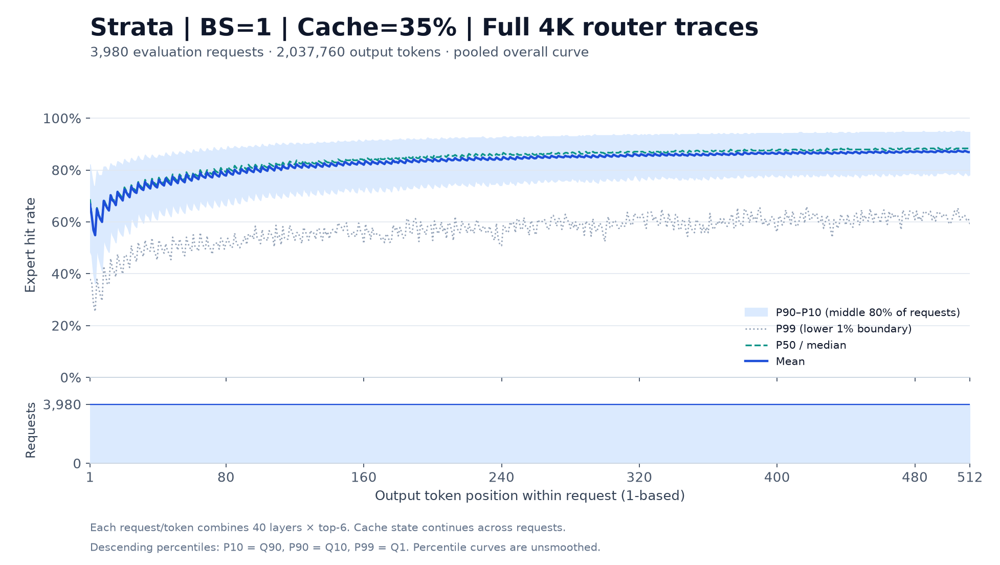
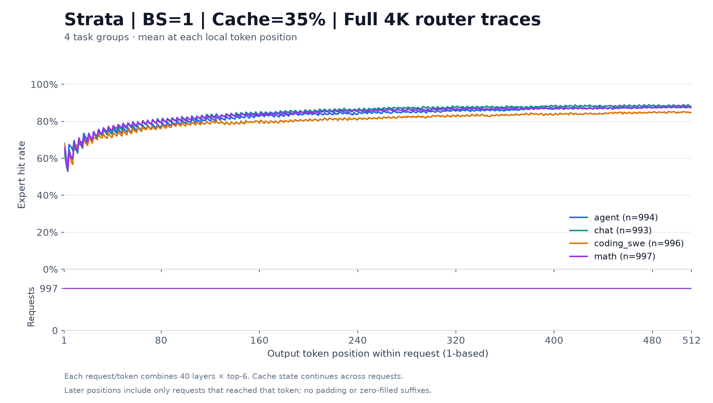

# Strata 请求内逐 token 命中率

使用已有完整 4K Router 实验的 sealed detail 后处理；没有重新回放缓存策略。设置保持 Strata、BS=1、常驻池 35%（3,584 units）、seed=20261018，前 20 条 profile、其余 3,980 条评估。

新 hook 完成分析耗时 **13.882 秒**，读取并校验 4,975 个 access 分片，共 81,510,400 条逐层标注，未扫描缓存事件。

## 统计口径

- 每个 request/token 先汇总 40 个有效层的命中数，除以 40 × 6 = 240；然后按请求内 token 位置聚合。
- 图中 token 从 1 开始；JSON 的 `token_index` 从 0 开始。每个位置均有 3,980 个请求；各任务的支持数在 512 个位置内保持不变。
- 均值为专家访问加权均值。P10/P50/P90/P99 的样本单位是 request/token，降序排名、线性插值；与旧报告的 request/token/layer 分位数不同。
- 图中的 P10–P90 阴影是请求间分布的中间 80%，P99 对应升序 Q1。默认曲线未经平滑。
- 原实验缓存跨请求保留；首 token 不代表空缓存。包含原有重复输出样本，曲线变化不能单独归因于策略适应。

## 总体曲线



| 输出位置 | 请求数 | 平均 | P10 | P50 | P90 | P99 |
|---|---:|---:|---:|---:|---:|---:|
| 1 | 3,980 | 66.81% | 82.08% | 68.75% | 48.75% | 37.92% |
| 4 | 3,980 | 54.84% | 73.75% | 55.00% | 36.25% | 25.42% |
| 16 | 3,980 | 66.44% | 80.83% | 66.67% | 52.04% | 38.75% |
| 64 | 3,980 | 76.43% | 86.67% | 77.50% | 64.58% | 48.75% |
| 128 | 3,980 | 80.95% | 90.00% | 82.50% | 70.00% | 52.92% |
| 256 | 3,980 | 84.44% | 92.92% | 85.83% | 74.58% | 54.83% |
| 512 | 3,980 | 86.91% | 94.58% | 88.33% | 78.33% | 59.08% |

## 分任务曲线



窗口值以对应 16 个位置的命中数 / 访问数计算；它们不是单个 token 点值，也不是对分位数取平均。

| 任务 | 请求数 | 前 16 token 平均 | 最后 16 token 平均 | 差值（百分点） | 全程平均 |
|---|---:|---:|---:|---:|---:|
| 总体 | 3,980 | 64.16% | 87.14% | +22.98 | 82.91% |
| agent | 994 | 65.90% | 87.61% | +21.72 | 82.99% |
| chat | 993 | 62.98% | 88.47% | +25.49 | 84.38% |
| coding_swe | 996 | 63.83% | 84.89% | +21.07 | 80.43% |
| math | 997 | 63.94% | 87.61% | +23.66 | 83.83% |

## 核验与复现

- 新曲线累计得到 405,461,796 次命中 / 489,062,400 次访问，准确还原原报告均值 82.9059432907%；各任务命中总数、访问总数也逐项一致。
- 每个 request/token 都校验了全部有效层的唯一覆盖；重复、缺失、越界标注会拒绝输出。
- 独立从 hit_mask 重新累加第 1、4、16、64、128、256、512 个 token 的 27,860 个请求/token、1,114,400 条层标注：总体和各任务均值、降序分位数均一致。
- 原 manifest、summary、detail 索引的 SHA-256 与此前归档清单一致，旧归档保持完整。分析与图表各自保存来源和实现指纹。

```bash
expertcache postprocess runs/strata-full4k-bs1-cache35-shuffled-20261018/strata-35pct \
  --only-hook expertcache.summary:TokenPositionHitRateSummary \
  --output runs/token-position-reproduce/summary.json

python -m pip install -e '.[plots]'
PYTHONPATH=src python scripts/plot_token_position.py runs/token-position-reproduce/summary.json \
  --output runs/token-position-reproduce/figures
```

图表可选 `--window 16` 显示按实际访问数加权的尾随窗口均值，分位数保持原始逐位置统计。输出文件/图表目录须为新路径。

- [完整 512 点总体与任务 summary](strata-full4k-bs1-cache35-token-position-20261018.json)
- [核验记录](strata-full4k-bs1-cache35-token-position-20261018-verification.json)
- [总体 SVG](strata-full4k-bs1-cache35-token-position-20261018-figures/overall.svg) · [分任务 SVG](strata-full4k-bs1-cache35-token-position-20261018-figures/by-task.svg)
- [图表来源](strata-full4k-bs1-cache35-token-position-20261018-figures/provenance.json)
- 本地分析目录：`runs/strata-full4k-bs1-cache35-token-position-20261018/`。旧实验目录、原始 summary 和归档清单保持原样。
